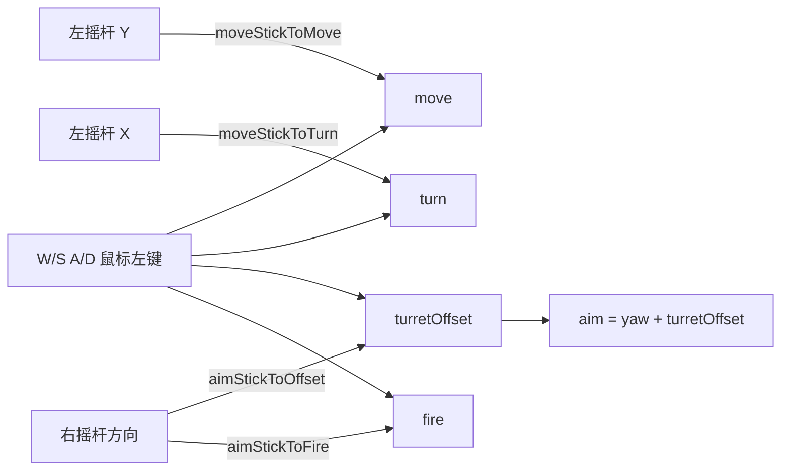

# 进度台账

> 按日期追加，不覆盖历史。

## 2026-11-16

- 建立工作区：`AGENTS.md` + `docs/需求规格-v0.1.md`。
- 需求收集完成，共 14 项决策已确认：
  - 经典 Battle City 规则 3D 重制；浏览器 + Three.js + TypeScript；单人 PvE。
  - 完整小游戏范围：10 关手工地图、4 地形、4 道具、3 类敌人、程序合成音效、localStorage 存档。
  - Low-poly 程序化几何；第三人称跟随 + 键鼠 pointer lock；车体自由移动 + 炮塔独立 360°。
  - 双难度档（经典档基地一击毁 / 休闲档基地 3 血 + 自动修复一次）。
  - Vite 工程 + 可部署静态包。
- 关键技术裁决已写入规格 §4：地图离散（26×26 格、格边 2 m）、实体连续；相机跟随车体而非炮塔。
- 状态：规格待用户确认冻结，未开始编码。
- 版本管理已初始化：
  - 本地 `git init -b main`，首次提交 `ea8fc9a`。
  - 远端私有仓库 `http://panyunmeng.cn:3000/panyunmeng/3d-tan-ke-da-zhan.git`（仓库名按 AlphaDashDot 转写），`main` 已推送并建立跟踪。
- 下一步：确认规格 → 搭 Vite + TS 工程骨架 → 垂直切片（操控 + 相机 + 碰撞 + 射击）。

## 2026-11-17 · v1.0 实现与验收

**完成内容**

- 单人战役：10 关（`scripts/gen-levels.py` 生成，内置坦克连通性校验）、4 地形、4 道具、3 类敌人、双难度档
- 渲染：程序化天空/地面/砖/钢/水/林纹理，InstancedMesh 合批，第三人称跟随相机（高度感知遮挡），3D 落点准星，粒子特效
- 音频：WebAudio 合成炮击/爆炸/引擎/道具/过关/失败 + 极简低音循环（默认关）
- 存档：localStorage（最高分、最远关、通关次数、难度、音效/音乐）
- 联机：Node + ws 服务器，60 Hz 权威仿真 / 20 Hz 快照，4 位房间码，双人合作
- 部署产物：Dockerfile（多阶段）+ docker-compose.yml + `docs/部署-FNOS.md`
- 调试设施：`?debug / ?demo / ?drive / ?level / ?screen`

**验证结果**

- `npm test`：59 项单测全绿（含 10 关战役连通性、确定性、实体不泄漏、边界）
- `node scripts/net-smoke.mjs`：两端 3 s 各推进 9.75 m、40 帧快照、同 tick 一致 40/40
- 浏览器实机：单人自动驾驶连续运行、联机双端同屏（`players p1@… p2@…`）

**踩到的关键坑（供后续参考）**

1. 本机 `%TEMP%` 有 ACL 限制，esbuild 清理临时文件报 Access is denied → `scripts/build.mjs` 统一把 TEMP/TMP 指到工作区 `.tmp/`
2. `ws` 打进 ESM bundle 会因动态 `require('events')` 崩 → esbuild 设 `external: ['ws', ...]`，运行时装生产依赖
3. 这个浏览器环境里 `requestPointerLock()` 抛 `WrongDocumentError`，异常直接打断 rAF 主循环 → 已 try/catch + 主循环兜底
4. 隐藏标签页会挂起 rAF（`visibilityState=hidden`），自动化截图看到的是冻结帧 → `?demo/?drive` 模式下用定时器按真实时间补齐帧
5. 坦克碰撞半径 1.05 时会被 2 m 宽走廊卡死（第 7 关玩家与 AI 同时卡住）→ 半径降到 0.95，并在关卡生成器里加连通性校验

**下一步（可选）**

- 对抗模式（双人 PvP）、更多关卡、道具扩展
- 若要在 NAS 上真实部署：`docker compose up -d --build` 后按 `docs/部署-FNOS.md` 验证 `/healthz`

## 2026-11-17 · 已自主部署到 NAS（FNOS）

- **线上地址**：http://panyunmeng.cn:8080/ （局域网 192.168.1.100:8080），容器 `tank3d`，镜像 `tank3d:1.0.0`，端口 8080→3000
- **主机路径**：`/home/panyunmeng/tank3d`；源码从 Windows 打包 scp，未在 NAS 上 clone
- **构建参数**：`NPM_REGISTRY=https://registry.npmmirror.com`（NAS 直连 npmjs 慢）；基础镜像走 daemon 既有镜像源 `docker.fnnas.com`
- **验收**：NAS 本机 `/healthz` 200；Windows 侧 `net-smoke ws://panyunmeng.cn:8080/ws` 通过（62 帧/3 s、双端各 15.25 m、同 tick 一致 62/62）；浏览器实机双人同屏可玩
- **两个坑**：① 改过 package.json 依赖分组后没重建 lock，容器 `npm ci` 失败（已用 `npm install --package-lock-only` 修复并提交）；② `panyunmeng` 不在 docker 组，docker 命令都要 `sudo -S`
- **遗留**：FNOS 上 3000 被 Gitea 占，所以用 8080；如需换端口改 `docker-compose.yml` 左侧端口后 `docker compose up -d`

## 2026-11-17 · 部署形态变更：独立容器下线，并入合集

本游戏的 NAS 部署已从「独立 docker 容器占 8080」改为「作为 3D 游戏合集应用
的一部分，跑在合集进程内」。原容器与镜像已删除，8080 释放。

**现在的入口**：
- 端口：`http://panyunmeng.cn:8081/games/tank/`
- 网关：`https://panyunmeng.cn:5667/app/3d-games/games/tank`
- 联机 WS：`ws://<host>:8081/games/tank/ws`（挂在合集进程内，不额外占端口）

**为并入合集对本项目做的三处改动**（合集会用到，单机部署不受影响）：
1. `vite.config.ts` 加 `base: './'` —— 子路径部署必需
2. `src/net/client.ts` 的 WS 端点改由 `location.pathname` 推导，不再写死 `/ws`
3. `server/index.ts` 导出 `attachWebSocket`，且**被 import 时不自启监听**
   （用 `isEntryScript()` 区分；`node dist-server/index.mjs` 行为与原来一致）

三处都已验证：`pnpm build` 通过，独立模式 `PORT=8097 node dist-server/index.mjs`
正常起服务。

**部署职责已转出**：本仓库不再负责 NAS 部署（`docker-compose.yml` /
`Dockerfile` 仍可本地用，但线上不再走这条）。部署脚本与文档在
`D:\MyProjects\X.AIProjects\3D游戏合集`。

旧容器的宿主目录备份：`/home/panyunmeng/tank3d-backup-20261117-1239.tar.gz`。

## 2026-11-18 22:49 — 移动端适配（触屏双摇杆 + 响应式 HUD）

**用户裁决口径**：纯触屏可完成一局；桌面 1440×900 不退化；`src/sim/` 一行不改。

### 摇杆映射方案与理由（第一性推导）

键盘路径的 `PlayerInput` 事实（app.buildInput）：`move=W/S`、`turn=A/D`、`aim=yaw+turretOffset`（turretOffset 由鼠标 movementX 累计）、`fire=左键`。规范只允许这 4 个字段，故触屏只能用这 4 个字段表达，不发明新语义：

- 左摇杆 Y→`move`（上推=+1=W），X→`turn`（右推=-1=D/顺时针，相机在车后 yaw 增大=车头向左）。
- 右摇杆方向→`turretOffset`，再走与鼠标完全相同的 `aim=yaw+turretOffset`。屏幕右=世界 -x，yaw 增大炮口转向 +x（屏幕左），故右推映射为负 yaw 偏移 `atan2(-x,-y)`；上推=正前方=偏移 0；回中=null（保持朝向，同鼠标不动）。
- **选「瞄准即开火」而非独立开火按钮**：手机只两只拇指，375px 竖屏加第三按钮会挤占右下角（平台「返回平台」占 12px 安全区），还需三指协同。推动右摇杆即置 `fire=true`，与按住左键共用字段。
- 死区 0.16 过滤手指微抖；`move/turn` 夹到 ±1，与仿真层对键盘输入的夹取一致。
- 纯映射抽到 `src/inputMapping.ts`（无 three/DOM/random），`tests/inputMapping.test.ts` 逐字段验证与键盘语义一致；app 实际调用同一组函数。
- 触屏模式由首次 `pointerdown(pointerType=touch)` 触发，桌面永不显示摇杆；触屏下 `requestPointerLock()` 直接 return（会失败且吞事件）。多点触控用 `pointerId` + `setPointerCapture` 区分左右摇杆。

### 断点 / 改动清单

- `src/inputMapping.ts`（新增）：纯映射函数 `stickDeadzone / moveStickToMove / moveStickToTurn / aimStickToOffset / aimStickToFire`。
- `src/app.ts`：新增 5 个触屏状态字段；bindInput 加首次触摸监听；buildInput 合入摇杆值（同一 PlayerInput）；frame 里右摇杆改 turretOffset；requestPointerLock 触屏短路；`enableTouchMode`；HUD hint/静音按钮同步。
- `src/ui/ui.ts`：`Stick` 类（Pointer Events + 捕获 + 死区）；HUD 加暂停/静音按钮；触屏摇杆层；`setTouchMode/isTouchMode/syncTouchLayer/syncMuteButton`；菜单加触屏操作说明。
- `src/style.css`：`100dvh` + `env(safe-area-inset-*)`；补 `--radius/--radius-lg` 默认值；双摇杆样式（132px，touch-action:none）；HUD 图标按钮 48px；窄屏/横屏媒体查询；按钮 min 48px；右下让位平台按钮。
- `index.html`：viewport 加 `viewport-fit=cover, user-scalable=no`。
- `tests/inputMapping.test.ts`（新增）：8 条映射语义单测。
- **未改** `src/sim/`（碰撞/伤害/火力/A*/地图/解析保持原样）；未 git commit/push。

### 验证结论

- `npm run typecheck`：通过（0 错误）。
- `npm test`：**67/67 全绿**（原 59 + 新增 8），6 个测试文件。
- `npm run build`：通过（vite 35 modules，dist + dist-server）。
- `mobile-check --name tank --dir "3D坦克大战" --root=dist --enter "...[data-act=solo].click()"`：**3/3 视口 PASS**，err=0 / overflowX=0 / canvas 覆盖 100% / minTap=48(竖)、46(横)、46(桌面) px，均 ≥44。
- 竖屏 play 态几何探针（375×812）：左摇杆 x20～152/y584～716、右摇杆 x223～355/y584～716，二者间距 71px、不重叠；战场中心约 (187,406) 未被摇杆覆盖；HUD 三面板在 y8～39、工具按钮 y45～93 均在视口内；scrollW=375=innerW 无横向溢出；右摇杆右缘 x355/bottom716 与平台返回按钮（right12/bottom12）不冲突。
- 截图：`.agents/work/mobile/tank-{portrait,landscape,desktop}[-play].png`。本模型无图像输入，未能直接 `read_image` 目视，已用 CDP 几何数据替代；请父 agent/人工看 `tank-portrait-play.png` 复核观感。

### 已知不足

- 双指缩放/手势未做（规范未要求）；摇杆为固定位置而非浮动式（跟随手指起点未实现）。
- 触屏模式一旦触发在当前页面生命周期内不回退（桌面混合设备插鼠标后仍显示摇杆，但键盘鼠标照常可用）。
- 右摇杆是「相对车体方向」而非屏幕绝对方向：车体转向时炮塔的相对角保持，需要玩家适应（与桌面鼠标 turretOffset 语义一致，是有意选择）。
- 本轮无法用 `read_image` 目视截图，目视验收转交人工。
- 未提交 git（按边界要求）。

## 2026-11-18 23:05 — 修掉底部提示叠印（lead 复核发现的缺陷）

**现象**：lead 看 `tank-portrait-play.png` 发现底部提示三句话糊成一行乱码。

**CDP 定位（不凭猜，实测底部 150px 带内所有可见元素）**：
- 竖屏 375×812：`span.hint`（父 `.ui-layer` z=10，rect [75,777,226,27]，文本「左摇杆移动 · 右摇杆瞄准开火 · 右上角暂停」）与 `div.touch-tip`（父 `.touch-layer` **z=12**，rect [112,785,151,15]，opacity 0.75，文本「左摇杆移动 · 右摇杆瞄准即开火」）y 区间重叠；z=12 盖在 z=10 上，两份不同文案叠印 → 视觉糊字。
- 横屏 844×390：`.touch-tip` 被横屏 `display:none`，只有 `span.hint` 一条，未叠印。
- 根因：我上一版同时加了 `.touch-tip`（触屏层）和沿用 HUD `.hint`，两个文案源并存；`updateHud` 与 `setPointerLocked` 都写 `.hint`，`.touch-tip` 又是静态第二份。

**改法**：
- `src/ui/ui.ts`：删掉触屏层里的 `.touch-tip` DOM，提示只保留 HUD `.hint` 一处文案源（触屏文案由 `updateHud`/`setPointerLocked` 按 `isTouchMode` 写入）。
- `src/style.css`：删 `.touch-tip` 样式与横屏 `display:none`；触屏下把 `.hint` 抬到摇杆上沿之上——竖屏 `bottom:240px`（hint y545～572，摇杆顶 584），横屏 `bottom:150px`（hint y210～240，摇杆顶 262），两者都避开摇杆与右下平台返回按钮（right12/bottom12）。

**量测证据（改后 CDP，只数「含『摇杆』二字的可见自身文字节点」）**：
- 竖屏 375×812：`visibleHintNodes=1`，`span.hint` rect [75,545,226,27]，文本「左摇杆移动 · 右摇杆瞄准开火 · 右上角暂停」，`hintBottom=572 <= stickTop=584` → `hintClearsStick=true`。
- 横屏 844×390：`visibleHintNodes=1`，`span.hint` rect [291,210,262,30]，同文案，`hintBottom=240 <= stickTop=262` → `hintClearsStick=true`。
- 切换时机：`enableTouchMode()`（首次真触摸）切 `is-touch` 并刷 `.hint`；`setPointerLocked()` 与 `updateHud()` 均按 `isTouchMode()` 取文案，桌面走键盘鼠标文案，二者互斥、只有一处 DOM 文本源。

**复核验收**：`npm run typecheck` 通过；`npm test` 67/67；`npm run build` 通过；`mobile-check` 三视口 PASS（minTap 48/46/46、err=0、overflowX=0、canvas 100%）。

**台账说明**：上一节「已知不足」里「本轮无法 read_image 目视」依旧成立——本次同样是 lead 目视图发现、我用 CDP 数据修与验，非本模型目视。未 git commit/push。

