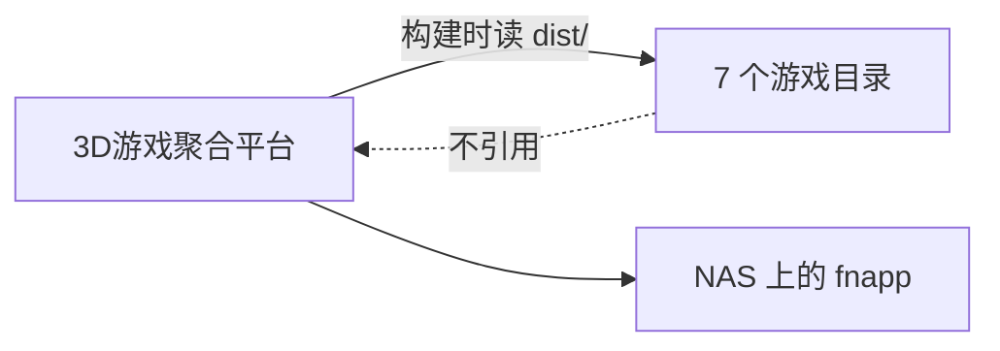

# 目录布局事实

> 2026-11-19 结构变更：8 个独立仓库已合并为 1 个单仓库，目录结构未变。
> 本文只记「这 8 个目录是什么关系」，不记各项目的进度与决策——那些在
> 各自目录的 `.agents/context/` 里。

## 8 个目录 = 同一仓库的 8 个子目录

| 目录 | 角色 | 合并前的仓库名（现已归档只读） |
| --- | --- | --- |
| `3D游戏聚合平台` | 平台：门户 + 服务 + 构建/打包/部署 | `3d-game-collection` |
| `3D经典贪吃蛇` | 游戏 | `3d-jingdian-tanchishe` |
| `3D俄罗斯方块` | 游戏 | `3d-eluosifangkuai` |
| `3D打砖块` | 游戏 | `3d-dazhuankuai` |
| `3D扫雷` | 游戏 | `3d-sao-lei` |
| `3D推箱子` | 游戏 | `3d-sokoban` |
| `3D塔防` | 游戏 | `3d-tafang` |
| `3D坦克大战` | 游戏 | `3d-tan-ke-da-zhan` |

现在统一在一个仓库里：

| 远端 | 地址 | 可见性 |
| --- | --- | --- |
| `origin` | `http://panyunmeng.cn:3000/panyunmeng/3d-games.git` | 私有 |
| `github` | `https://github.com/panyunmeng/3d-games.git` | 公开 |

## 依赖方向（单向）

**平台读游戏，游戏不知道平台存在**。反过来不成立，这是设计约束：
游戏目录里 grep 不到任何对平台的引用。

## 关键事实

- 根目录**有** `.git`（合并后），8 个目录是普通子目录、里面没有 `.git`
- 各游戏 `dist/` 在 `.gitignore` 里 → clone 完必须各自构建一次
- 目录名是中文，git 与 GitHub 都能正常处理（`git subtree` 已验证）
- 平台用 `GAMES_ROOT` 定位游戏，默认取平台根的上一级 —— 合并后这个逻辑不变，
  所以构建脚本一行没改
- 合并保留历史：`git subtree add` 逐目录并入，原 69 个提交都在
