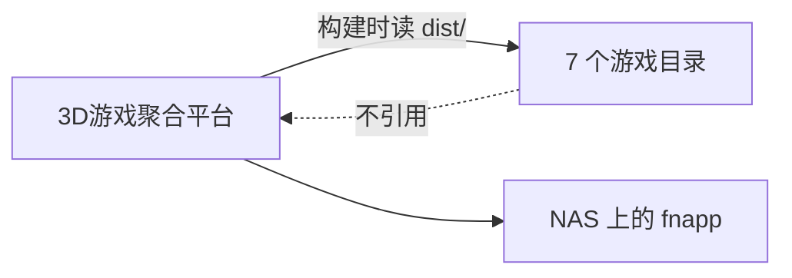

# 目录布局事实

> 本层是**容器**，不是仓库。只记「这 8 个目录是什么关系」这类事实，
> 不记各项目的进度与决策——那些在各自仓库的台账里。

## 8 个平级目录 = 8 个独立仓库

| 目录 | 角色 | 远端 |
| --- | --- | --- |
| `3D游戏聚合平台` | 平台：门户 + 服务 + 构建/打包/部署 | `3d-game-collection` |
| `3D经典贪吃蛇` | 游戏 | `3d-jingdian-tanchishe` |
| `3D俄罗斯方块` | 游戏 | `3d-eluosifangkuai` |
| `3D打砖块` | 游戏 | `3d-dazhuankuai` |
| `3D扫雷` | 游戏 | `3d-sao-lei` |
| `3D推箱子` | 游戏 | `3d-sokoban` |
| `3D塔防` | 游戏 | `3d-tafang` |
| `3D坦克大战` | 游戏 | `3d-tan-ke-da-zhan` |

全部在 `http://panyunmeng.cn:3000/panyunmeng/` 下，私有。

## 依赖方向（单向）

**平台读游戏，游戏不知道平台存在**。反过来不成立，这是设计约束：
游戏目录里 grep 不到任何对平台的引用。

## 关键事实

- 容器根**没有** `.git`，且不应有（会让 8 个子仓库变成嵌套仓库）
- 各游戏 `dist/` 在各自 `.gitignore` 里 → clone 完必须各自构建一次
- 仓库名是拼音、目录名是中文 → clone 时必须手动指定目录名
- 平台用 `GAMES_ROOT` 定位游戏，默认取平台根的上一级
