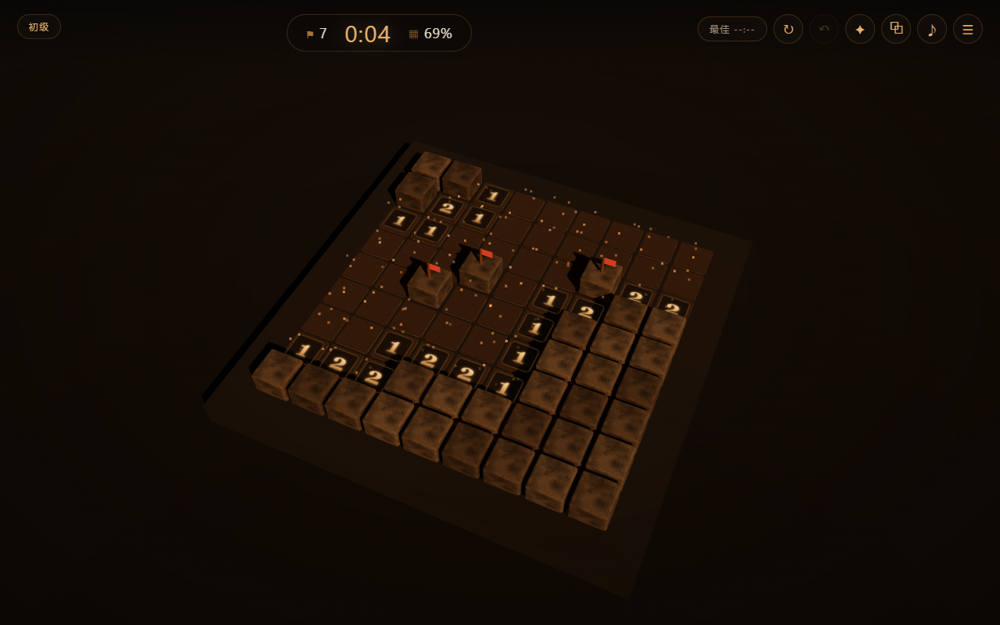

# 3D 扫雷 · 矿洞

浏览器端 **Three.js + 原生 ES Module** 的立体扫雷：经典 2D 规则，矿洞岩层视觉。零构建、零外部素材、离线可跑。



## 运行

```bash
node scripts/serve.mjs          # http://127.0.0.1:5502/
node --test "tests/*.test.mjs"  # 规则层单测
```

浏览器回归：跑起服务后打开 `http://127.0.0.1:5502/tests/browser/interaction-test.html`，标题变成 `PASS n/n` 即全绿。

直接双击 `index.html` 打不开——ES Module 在 `file://` 下会被同源策略拦掉，必须走本地静态服务。

## 玩法

- **左键**挖开，**右键**插旗，**拖动**旋转视角，**滚轮**缩放。
- 首击必定安全；0 格连锁展开。
- 三档难度：初级 9×9/10 雷、中级 16×16/40 雷、高级 30×16/99 雷。
- **双击数字**或按**中键**：旗数与数字相符时一次展开周围（和弦）。
- 撤销、提示各 3 次；用过其一，本局记为「练习局」，不计最佳成绩。
- 最佳成绩按难度存在 localStorage。

## 分享

分享按钮会复制带种子的链接：`?seed=<6位>&level=<easy|medium|hard>`，朋友打开即同难度同随机源开局。

## 结构

```text
index.html        页面骨架（HUD / 菜单 / 结算）
styles.css        矿洞主题样式
src/logic.js      规则核心（纯数据，可单测）
src/rng.js        种子随机数
src/board3d.js    棋盘网格、状态显隐、动效
src/particles.js  粒子池（扬尘 / 爆炸 / 烟花）
src/scene.js      渲染器、相机轨道、灯光
src/textures.js   程序化贴图（岩石 / 铜色数字 / 焦痕）
src/audio.js      WebAudio 合成音效
src/ui.js         DOM 层
src/main.js       入口与状态机
tests/            规则层单测 + 浏览器回归页（tests/browser）
vendor/           three.module.js（本地副本）
```
