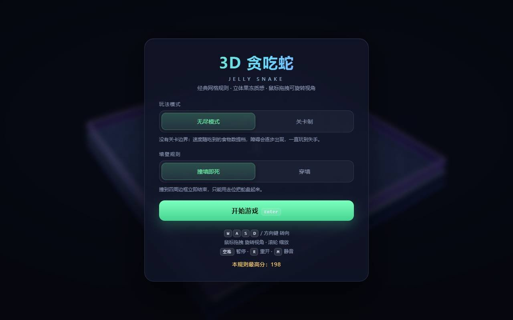
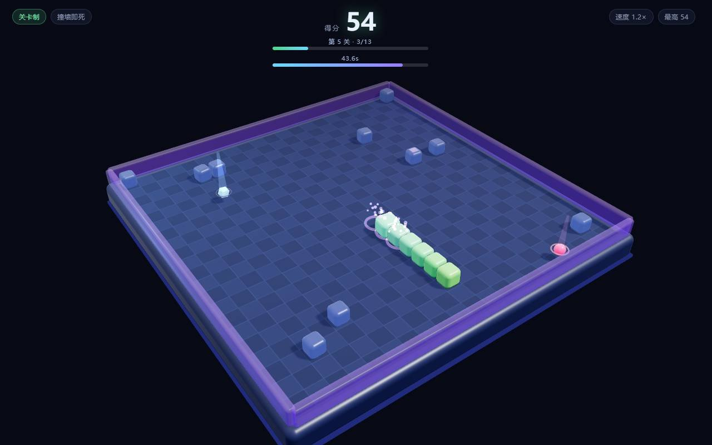

# 3D 贪吃蛇 · Jelly Snake

经典贪吃蛇的规则不变，只是把棋盘搬进了一个有光、有厚度、可以转着看的果冻世界。
纯前端、零构建、不依赖任何联网资源：`three.js` 已经放在 `vendor/` 里。



## 玩法

两个独立维度，开局在菜单里各选一个：

| 玩法模式 | 说明 |
| --- | --- |
| **无尽模式** | 没有关卡边界。每吃 4 个食物提一档速度，吃到 8 个后开始出现障碍，一直玩到失手。 |
| **关卡制** | 每关有目标食物数与倒计时。达标过关、按剩余秒数加分；过关后障碍更多、速度更快、蛇身保留。 |

| 墙壁规则 | 说明 |
| --- | --- |
| **撞墙即死** | 撞到四周边框立即结束（经典规则）。 |
| **穿墙** | 从一侧穿出、对侧进入；撞到自己或障碍照样结束。 |

道具每吃 2 个食物刷新一个，场上最多一个，15 秒没捡就消失：

| 道具 | 外形 | 效果 |
| --- | --- | --- |
| 加速 | 橙色八面体 | 步长 ×0.62，持续 6 秒（和减速互斥，后捡的生效） |
| 减速 | 蓝色多面体 | 步长 ×1.45，持续 6 秒，长蛇时用来解围 |
| 限时 | 金色圆环 | 关卡制：本关 +8 秒；无尽制：8 秒内双倍得分 |



## 操作

| 按键 | 作用 |
| --- | --- |
| `W` `A` `S` `D` / 方向键 | 转向（**按屏幕方向**，会自动跟着相机方位换算成世界方向） |
| 鼠标拖拽 | 旋转视角；滚轮缩放；双击复位 |
| `空格` | 暂停 / 继续 |
| `R` | 重开一局（沿用当前模式与墙规则） |
| `Enter` | 菜单开局 / 结算后重开 |
| `M` | 静音开关 |

## 运行

```bash
node scripts/serve.mjs 5501
# 打开 http://127.0.0.1:5501/
```

也可以 `python -m http.server 5501`。**不能直接双击 `index.html`**：
页面用的是 ES Module，`file://` 下会被同源策略拦掉，控制台一片 `CORS` 报错。

## 数值

想改手感只动 [src/config.js](src/config.js)，逻辑代码里没有魔数：

- 棋盘 21×21；初始步长 168 ms/格（约 6 格/秒），下限 62 ms、上限 460 ms。
- 关卡制：第 L 关目标 `5 + 2(L-1)` 个食物、限时 `30 + 2.5(L-1)` 秒、每吃一个补 1.2 秒，
  第 2 关起出现障碍 `min(18, 4 + 2(L-2))` 个，每关步长 −8 ms。
- 无尽制：每 4 个食物步长 −6 ms，每 4 个食物长 1 个障碍（最多 20），分数随累计食物缓慢上涨。
- 过关奖励 = 剩余秒数 × 3。

## 代码结构

```
index.html            页面骨架 + 菜单/HUD/暂停/结算 的 DOM
styles.css            全部样式（无外部字体）
src/config.js         所有可调参数
src/logic.js          纯规则：格坐标、碰撞、生成、关卡推进、计时器（不 import three）
src/scene.js          场景：渲染器、光照、环境反射、棋盘、墙/传送门、相机控制
src/view.js           表现：果冻蛇身、食物、道具、障碍、粒子与冲击环
src/ui.js             菜单/HUD/横幅/结算，最高分读写
src/audio.js          WebAudio 现场合成音效（无音频文件）
src/main.js           状态机、三套时钟、输入映射、调试入口
scripts/serve.mjs     零依赖静态服务器
tests/logic.test.mjs  单条规则断言
tests/simulation.test.mjs  BFS 机器人把整局跑完，校验全局不变量
vendor/               three.js r170 + RoundedBoxGeometry（本地化，离线可用）
```

## 设计要点（为什么这么写）

1. **逻辑与渲染分离，三套时钟。** 规则是离散的（每 tick 走一格），画面是连续的（每秒 60 帧），
   计时是真实毫秒（道具/关卡倒计时）。混成一个 `update(dt)` 时，速度一变就会让一帧走两格，
   或者让倒计时被帧率影响。现在 `logic.js` 不依赖 three、可在 node 里跑，改规则先跑单测。
2. **输入按相机投影。** 相机转了之后，如果 WASD 还映射到固定的世界方向，玩家会觉得“上下反了”。
   现在按键先算屏幕的上/右向量，再量化到世界四方向中主导的那一个。
3. **穿墙不插值。** 身体段从 `prevSnake[i]` 插值到 `snake[i]`；穿墙时两点相距整张棋盘，
   插值会横穿画面，所以检测到距离 > 1.4 格就直接吸附，并补一次粒子提示。
4. **生成器不讲理的地方要堵住。** 障碍必须离蛇头 2 格以上，否则可能直接刷在下一格等于强制死亡；
   食物/道具/障碍三者互不重叠，填充率不够时退化成顺序扫描，保证一定能取到空位。
5. **开局给反应时间。** 出生点从正中心下移到倒数第 6 行（朝上还有 15 格 ≈ 2.5 秒），
   外加 900 ms 起步缓冲。正中心开局只剩 10 格 ≈ 1.7 秒，低于真人“看见→判断→按键”的时间。

## 测试

```bash
node --test tests/*.test.mjs
```

- `logic.test.mjs`：20 条规则断言（撞墙/穿墙/自撞/踩尾格/障碍/成长/关卡达标与推进/超时/三种道具/
  食物不落在蛇身上/速度曲线单调）。
- `simulation.test.mjs`：BFS 机器人连打几千 tick，每 tick 校验不变量——蛇身不越界不自交、
  障碍不压蛇身、食物不在蛇身或障碍上、`蛇长 == 4 + 累计食物数`、道具 TTL 合法。
  关卡制机器人实测能连过 7 关、吃到 79 个食物。

## 调试场景

验收截图不想按一千次键时，用 URL 参数直接摆出某个局面（摆完会冻结 tick，正常玩不受影响）：

```
/?scene=level&n=4         关卡制第 4 关（带障碍）
/?scene=long&n=18         18 节长蛇
/?scene=obstacles&n=40    无尽模式吃 40 个后的障碍密度
/?scene=items&kind=slow   场上放一个指定道具（speed/slow/time）
/?scene=over              直接进入结算
/?scene=pause             暂停面板
&wall=wrap                墙规则；&mode=level|endless 指定模式
&theta=0.55&phi=0.78&zoom=34   指定相机方位/俯仰/距离
```

浏览器里还挂了 `window.__snake`（`start/step/feed/dir/info`），方便从控制台驱动一局。

## 已知边界

- 触屏只做了拖拽转视角（需求只要求键盘），没有虚拟摇杆。
- 无后端：最高分按「模式+墙规则」四组存在 `localStorage`。
- 穿墙瞬间身体段是吸附不是滑动动画（原因见上）。
- `vendor/` 是手工置入的定版依赖，升级 three 时要同步改 `RoundedBoxGeometry` 的 import 路径。
