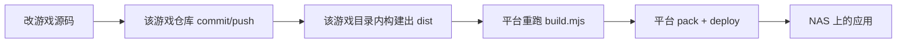

# 3D 游戏合集 · 容器根

> 本文件是**导航**，不是事实来源。每个子目录都是独立仓库，各自的
> `AGENTS.md` 与 `.agents/` 才是那个项目的权威说明，冲突时以子目录为准。

## 动手前先读

- `.agents/constraints/navigation.md` —— 容器层的硬约束（不要在此建 git 等）
- `.agents/constraints/resource-discipline.md` —— **资源纪律**（浏览器不得常驻、
  子代理不得各自开浏览器、并发上限）。跑任何 CDP/无头浏览器验收前必读
- `.agents/context/layout.md` —— 8 个目录的角色、远端、依赖方向
- `.agents/context/mobile-spec.md` —— **移动端适配规范**（触屏输入、布局、验收判据），
  改任何游戏的移动端适配前必读
- 要动某个项目 → 读**那个子目录**的 `AGENTS.md`，那才是权威

## 移动端验收（工具，跨仓库共用）

7 个游戏共用一套验收口径，工具在容器层，跑法：

```bash
node .agents/work/tools/mobile-check.mjs --name=<id> --dir="<游戏目录>" [--root=dist] [--enter="<进对局的 JS>"]
```

一次跑竖屏 375×812 / 横屏 844×390 / 桌面 1440×900 三个视口，判据是
控制台零报错、无横向滚动、canvas 未被遮挡、最小可点元素 ≥44px。任一不过退出码 1。
截图落在各游戏自己的 `.agents/work/mobile/`（不进 git）。

## 这是什么

只是一个**文件夹**，不是仓库——根目录没有 `.git`，也不该有。

下面 8 个**平级目录 = 8 个独立 git 仓库**，其中 1 个是平台、7 个是游戏。

```text
3D游戏合集/                    ← 容器（本层无 .git）
├── 3D游戏聚合平台/            ← 平台：门户页 + 服务 + 构建/打包/部署
├── 3D经典贪吃蛇/
├── 3D俄罗斯方块/
├── 3D打砖块/
├── 3D扫雷/
├── 3D推箱子/
├── 3D塔防/
└── 3D坦克大战/
```

## 从哪开始

**想构建 / 部署 / 改门户** → 进 `3D游戏聚合平台/`，读它的 `AGENTS.md`。

**想改某个游戏** → 进那个游戏目录，读它自己的 `AGENTS.md`。
改完记得回平台重跑构建，否则线上不会更新（见下）。

**只是想知道线上跑的是什么** → `http://panyunmeng.cn:8081/`

## 关系与约束

| 事实 | 说明 |
| --- | --- |
| 平台与游戏平级 | 平台**不包含**游戏，游戏也**不引用**平台 |
| 平台只读产物 | 构建时从上一级各游戏目录读 `dist/`，产物不回流 |
| 产物不入库 | 7 个游戏的 `dist/` 都在各自 `.gitignore` 里，clone 完必须各自构建一次 |
| 目录名是中文 | 仓库名是拼音（`3d-sokoban`），目录名是中文（`3D推箱子`），clone 时要手动指定 |

## 改了游戏之后

游戏仓库与线上是**两个实例**，改了游戏代码不会自动更新线上。完整链条：



漏掉任何一步，线上就还是旧的。平台侧的具体命令在它自己的 `AGENTS.md` 里。

## 独立仓库清单

| 目录 | Gitea 仓库 |
| --- | --- |
| `3D游戏聚合平台` | [3d-game-collection](http://panyunmeng.cn:3000/panyunmeng/3d-game-collection) |
| `3D经典贪吃蛇` | [3d-jingdian-tanchishe](http://panyunmeng.cn:3000/panyunmeng/3d-jingdian-tanchishe) |
| `3D俄罗斯方块` | [3d-eluosifangkuai](http://panyunmeng.cn:3000/panyunmeng/3d-eluosifangkuai) |
| `3D打砖块` | [3d-dazhuankuai](http://panyunmeng.cn:3000/panyunmeng/3d-dazhuankuai) |
| `3D扫雷` | [3d-sao-lei](http://panyunmeng.cn:3000/panyunmeng/3d-sao-lei) |
| `3D推箱子` | [3d-sokoban](http://panyunmeng.cn:3000/panyunmeng/3d-sokoban) |
| `3D塔防` | [3d-tafang](http://panyunmeng.cn:3000/panyunmeng/3d-tafang) |
| `3D坦克大战` | [3d-tan-ke-da-zhan](http://panyunmeng.cn:3000/panyunmeng/3d-tan-ke-da-zhan) |

## 本层要不要进版本管理

**不要**。容器根没有 `.git`，也不建——8 个子仓库已经完整覆盖了内容。
在这里 `git init` 只会把它们全部变成嵌套仓库，`git status` 一团乱。

因此本文件与 `.agents/` 都不受版本管理，只在本机存在。改动不会丢，
因为它只做导航，权威内容都在子仓库里。
