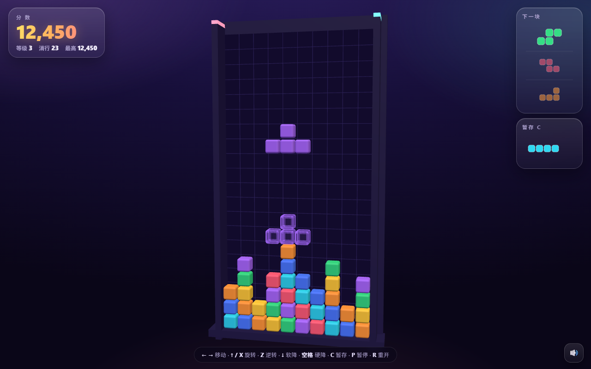

# 3D 俄罗斯方块

经典 10×20 判定 + 立体糖果积木渲染。单文件、离线可用、双击即玩。



## 玩法

- 判定平面是经典 10 列 × 20 行，消行规则不变；方块用圆角积木在透视视角里渲染
- 支持 **7-bag 随机**、**SRS 踢墙旋转**、**幽灵落点**、**下一块预览**、**Hold 暂存**、**连击 / T-spin 计分**、**等级递进**
- 相机是固定斜俯视，**鼠标拖动可微转视角**，只改观感、不改判定——看到的落点就是判到的落点

## 运行

双击 `index.html`。不需要服务器、不需要联网、不需要 npm。

## 操作

| 键 | 作用 |
| --- | --- |
| `←` `→`（或 `A` `D`） | 左右移动（带 DAS 连发：按住 150 ms 后每 45 ms 一格） |
| `↑` / `X`（或 `W`） | 顺时针旋转 |
| `Z` / `Ctrl` | 逆时针旋转 |
| `↓`（或 `S`） | 软降（每格 +1 分） |
| `空格` | 硬降（每格 +2 分） |
| `C`（或 `Shift`） | 暂存 / 取出（每块限一次） |
| `P` / `Esc` | 暂停 |
| `R` | 重开 |
| `M` | 静音 |
| 鼠标拖动画面 | 微转视角（不参与判定） |

## 开发

```bash
python build.py            # src + vendor → 单文件 index.html（产物，勿手改）
npm run check              # 语法检查 + 25 条内核单测
npm run build              # 同上重建
```

### 源码结构

```text
3D俄罗斯方块/
├── index.html                    # 产物：内联 three + 内核 + 渲染，双击即玩
├── build.py                      # vendor + src → index.html
├── src/
│   ├── shell.html                # HUD / CSS / 覆盖层模板（占位符内联脚本）
│   ├── core.js                   # 纯逻辑：判定、SRS、7-bag、计分、T-spin（无 DOM）
│   └── game.js                   # 渲染与交互：Three.js 场景、输入、音效、主循环
├── tests/core.test.js            # 内核单测（node --test，零依赖）
├── vendor/
│   ├── three.min.js              # Three.js r149 UMD（经典 script，file:// 可用）
│   └── RoundedBoxGeometry.js     # 圆角盒几何体（改成经典 script 版）
└── .agents/                      # 约束 / 台账 / 过程截图（不进交付）
```

### 为什么是单文件 + 经典 script

交付要求「双击即玩」，而 `file://` 下 `type="module"` 会被 CORS 拦。所以：

1. 全部脚本用经典 `<script>`（`THREE` 与 `TetrisCore` 走全局）；
2. `build.py` 把 three、圆角几何、内核、渲染四段内联进一个 HTML；
3. `core.js` 同时支持 `module.exports`，让 node 能直接 `require` 跑单测——规则只有一份，浏览器和测试跑的是同一段代码。

### 调试入口（URL 参数）

| 参数 | 作用 |
| --- | --- |
| `?selftest=1` | 在真实内核上跑随机对局 + WebGL/渲染管线断言，6 条结果直接画在覆盖层上 |
| `?demo=1` | 冻结一个「玩到一半」的盘面，用于目视验收配色与积木质感 |
| `?scenario=tetris` | 摆好「竖 I 一落即四连消」的局面，按一次空格即可看消行闪光与 TETRIS 提示 |
| `?autoplay=N` | 自动向左堆 N 块；N 足够大时会自然顶到出生点，用于验证完整一局到「游戏结束」 |
| `?fps=1` | 左下角显示实时帧率与状态 |
| `?seed=N` | 固定随机种子，复现同一局的方块序列 |

## 计分

| 消行 | 基础分（×等级） |
| --- | --- |
| 单消 | 100 |
| 双消 | 300 |
| 三消 | 500 |
| 四消（TETRIS） | 800 |
| T-spin 单 / 双 | 800 / 1200 |
| T-spin mini 单 / 双 | 100 / 400 |

另加：back-to-back（连续四消或 T-spin）×1.5、连击 50×连击数×等级、软降每格 +1、硬降每格 +2。

## 已验证

- 内核单测 25/25：形状与旋转自洽、踢墙表、7-bag、消行、计分、T-spin、等级、锁定延迟、400 步随机对局不变量、同种子可复现
- 浏览器自检 6/6（`?selftest=1`）
- 实测帧率 120 fps（120 Hz 显示器，渲染循环满帧）
- 完整一局：开始 → 消行 → 升级 → 游戏结束 → 重开，均在真实浏览器里跑通
- 证据截图见 `.agents/work/visual/`

## 已知限制

- 没有触控操作（键盘优先，移动端只做了布局自适应，未做手势）
- 没有背景音乐（音效为 WebAudio 实时合成，见 `src/game.js` 的 `Sound`）
- 出生点在可视区内（不做隐藏行），顶到出生点即结束
