<div align="center">

# 3D 游戏合集

**七个纯前端 3D 小游戏 + 一个门户** · Three.js · 零外部素材 · 手机可玩

[](http://panyunmeng.cn:8081/)
[](#七个游戏)
[](#技术栈)

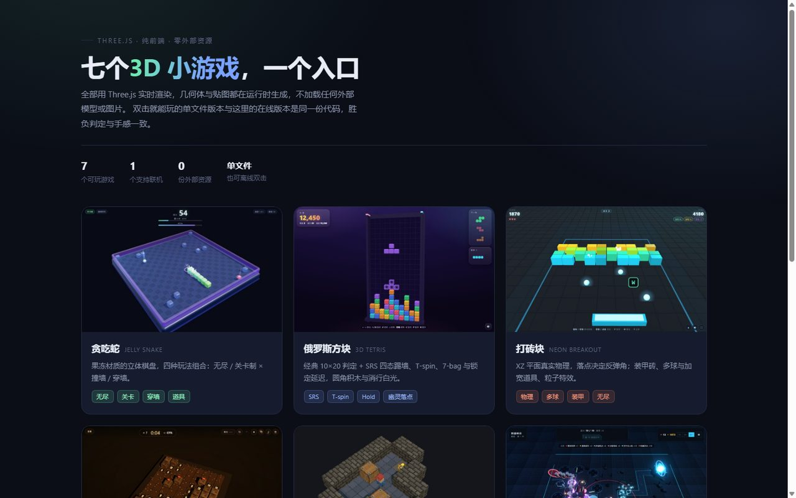

</div>

---

## 这是什么

七个经典玩法各自用 Three.js 做了 3D 重制，再套一层门户把它们聚成一个应用。
所有几何体、贴图、音效**全部在代码里程序化生成**，仓库里没有一张贴图、
一个模型、一个音频文件 —— 断网也能完整运行。

七个游戏都是**纯前端**（除了坦克大战的联机服务），判定与渲染严格分离：
规则层不碰 DOM、不碰 Three.js，因此可以脱离浏览器做单元测试。

## 七个游戏

| | 游戏 | 玩法内核 | 触屏 |
| --- | --- | --- | --- |
| 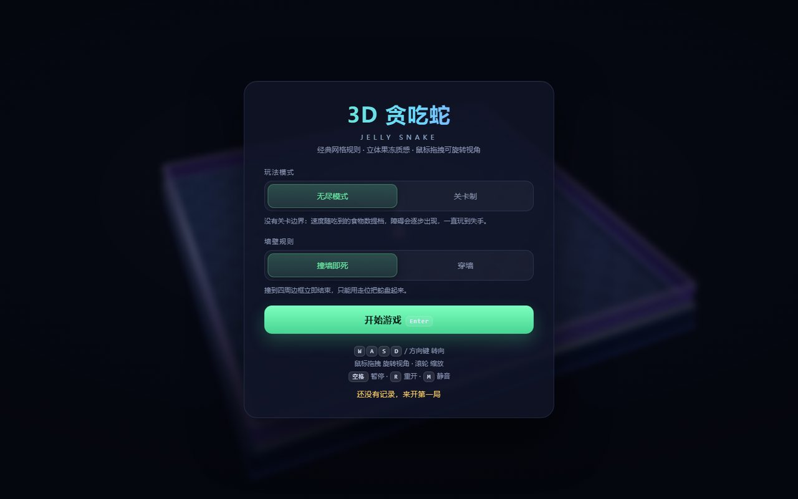 | **贪吃蛇**<br/>Jelly Snake | 21×21 离散网格 · 无尽/关卡 × 撞墙/穿墙 四组合 · 三种限时道具 | 右下十字方向键 |
| 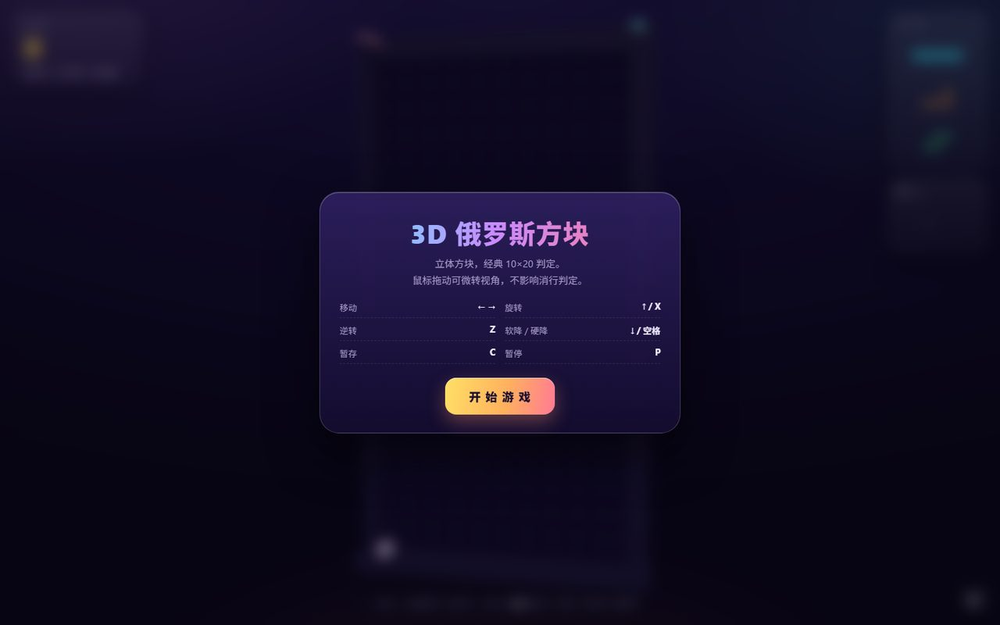 | **俄罗斯方块**<br/>3D Tetris | SRS 四态踢墙 · T-spin · 7-bag · 锁定延迟 · Hold · 幽灵落点 | 8 键触控条 |
| 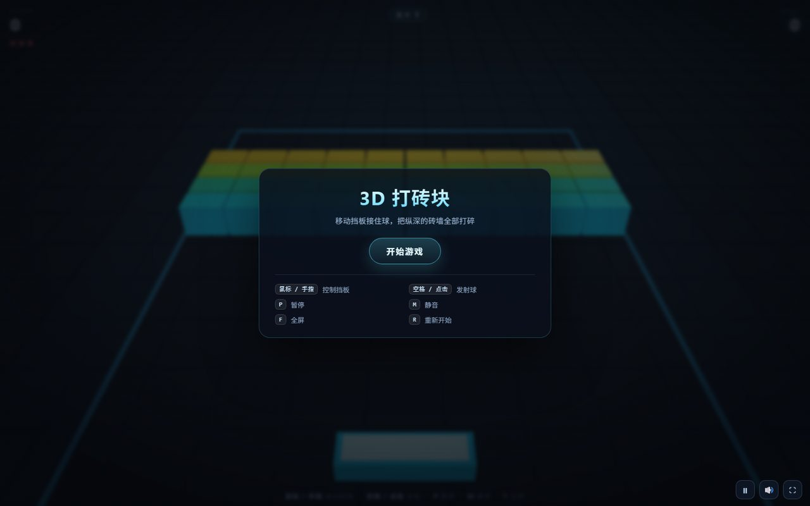 | **打砖块**<br/>Neon Breakout | XZ 平面真实物理 · 落点决定反弹角 · 装甲砖/多球/加宽 | 相对拖动 + 遮挡补偿 |
| 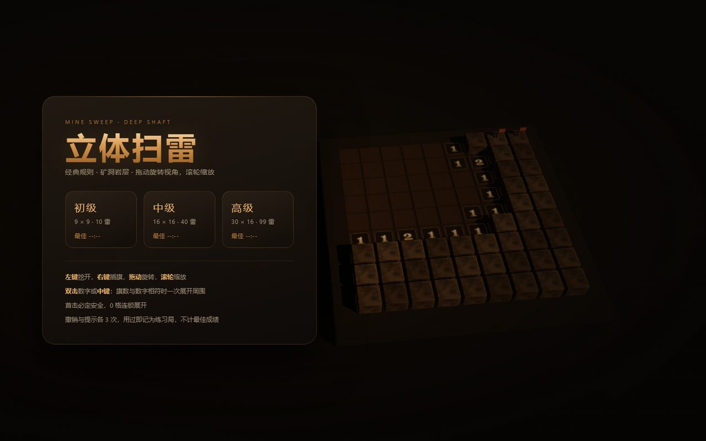 | **扫雷**<br/>Mine Cave | 首击安全 · 和弦展开 · 撤销/提示 · 种子分享 | 长按插旗 · 双指缩放 |
| 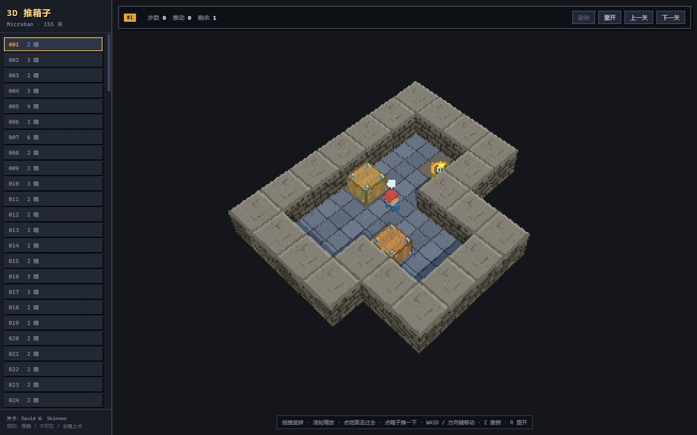 | **推箱子**<br/>Sokoban | Microban 155 关 · 点击寻路 · 撤销 | 十字键 + 关卡抽屉 |
| 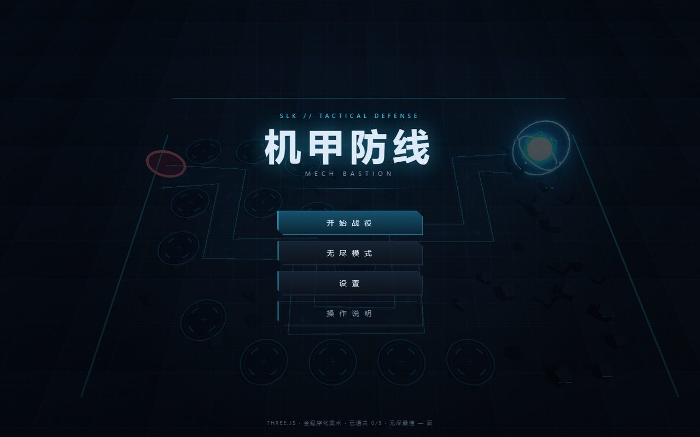 | **塔防**<br/>Mech Bastion | 四塔三级 · 八种敌人 · 三关十波三档难度 · 无尽模式 | 单指平移 · 双指缩放 |
| 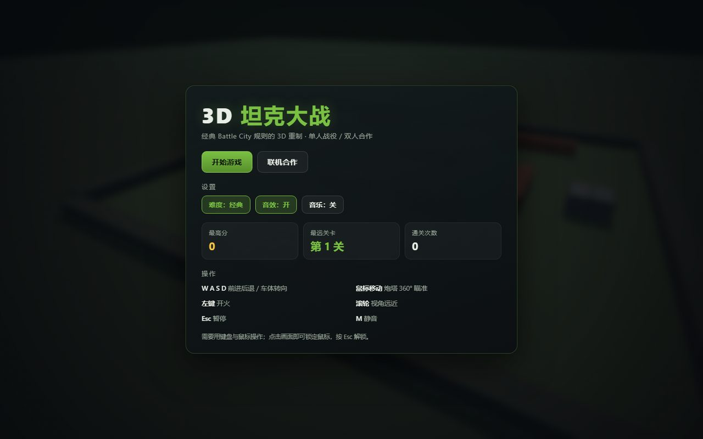 | **坦克大战**<br/>Battle City 3D | 10 关战役 · 四种地形 · 双人联机合作 · 服务端权威仿真 | 双摇杆 |

<div align="center">
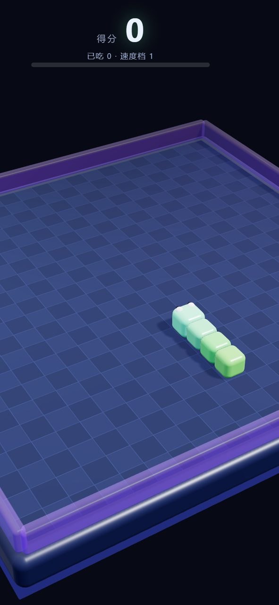
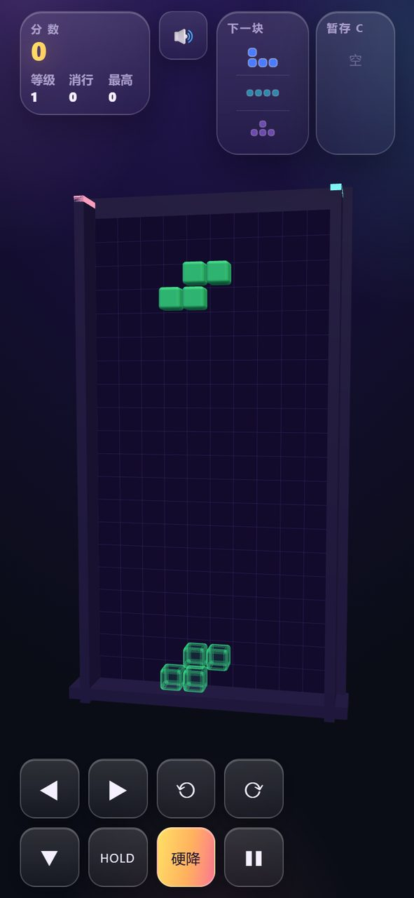
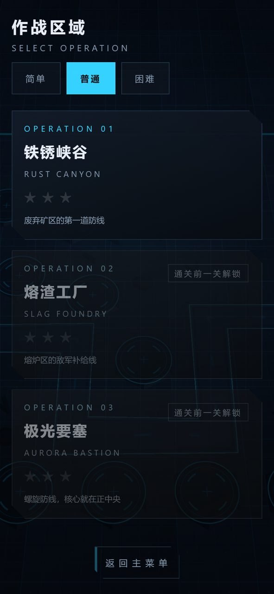
</div>

## 技术栈

| | |
| --- | --- |
| 渲染 | Three.js（版本按游戏固定，全部 vendor 到本地） |
| 语言 | 原生 ES Module（4 个游戏）/ TypeScript + Vite（3 个游戏） |
| 构建 | 零构建，或 `vite build`，或 `python build.py` 内联成单文件 |
| 服务 | Node 原生 `http` + `ws`，无框架 |
| 部署 | fnOS 原生应用（`.fpk`），单进程同时提供页面与联机服务 |

**没有引入任何前端框架**，也没有 `react` / `vue` / `webpack` / `tailwind`。
每个游戏是自包含的，改一个不会影响另一个。

## 怎么跑

### 单个游戏（最快）

```bash
# 零构建的游戏（贪吃蛇 / 扫雷）
cd 3D经典贪吃蛇 && node scripts/serve.mjs 5501

# 单文件游戏（俄罗斯方块 / 打砖块）：先构建，之后双击 index.html 就能玩
cd 3D俄罗斯方块 && python build.py && start index.html

# Vite 工程（推箱子 / 塔防 / 坦克大战）
cd 3D推箱子 && pnpm install && pnpm dev
```

### 合集（门户 + 全部游戏）

```bash
cd 3D游戏聚合平台
npm install
# 先让 7 个游戏各自产出 dist/ 或产物（见各游戏目录的 README）
node scripts/build.mjs        # 收集产物 → build/www
PORT=8099 node server/index.mjs
```

打开 `http://127.0.0.1:8099/` 就是门户页。

## 目录

```text
.
├── 3D游戏聚合平台/      门户页 + 服务 + 构建/打包/部署脚本
├── 3D经典贪吃蛇/        原生 ES Module，零构建
├── 3D俄罗斯方块/        python build.py → 单文件 index.html
├── 3D打砖块/            python build.py → 单文件 index.html
├── 3D扫雷/              原生 ES Module，零构建
├── 3D推箱子/            Vite + TypeScript
├── 3D塔防/              Vite + TypeScript
├── 3D坦克大战/          Vite + TypeScript + WebSocket 联机服务
└── docs/screenshots/    截图
```

每个目录都有自己的 `README.md`，写清了该游戏的玩法、命令、调试参数与踩坑。
平台的 `docs/设计语言规范.md` 是七个游戏共用的字体/色彩/圆角/键位/文案规范。

## 设计上的一些取舍

**为什么判定与渲染分离**：规则层（`logic.js` / `core.js` / `sim/`）不 import
three、不碰 DOM，所以能用 `node --test` 或 Vitest 直接测。碰撞、计分、生成
这些真正会算错的东西，全都在可单测的那一侧。

**为什么不引框架**：每个游戏只有几千行，一个游戏的状态机用不着框架。引入
框架只为了省几百行 DOM 操作，却让「打开文件就能读懂」变成「先学一遍框架」。

**为什么截图里的数字很小**：这些游戏的目标是「打开就看得到玩法」，不是
填满屏幕的商业化产品。

## 第三方素材与许可

- **Three.js** —— MIT，各游戏 `vendor/` 里有对应版本的副本与许可声明。
- **Microban 关卡集**（推箱子 155 关）—— 作者 David W. Skinner，其声明为
  可自由分发、须保留署名。署名已写在游戏内与 `3D推箱子/README.md`。
- 其余玩法均为经典规则的独立实现，不含任何原作的美术、音频或关卡数据。

玩法规则本身不受版权保护；「俄罗斯方块 / Tetris」是第三方商标，本仓库
仅作为玩法描述的通用称呼使用，与商标持有人无关。

**本仓库代码暂未授予开源许可**（All rights reserved）。如果你要复用其中
某部分，请先联系作者。

## 移动端

七个游戏都做了手机适配：触屏操控 + 响应式 HUD + 竖屏可玩，最小可点元素
44px，右下角给平台的「返回平台」留出安全区。验收用无头浏览器在
375×812 / 844×390 / 1440×900 三个视口逐个截图并检查控制台报错。
