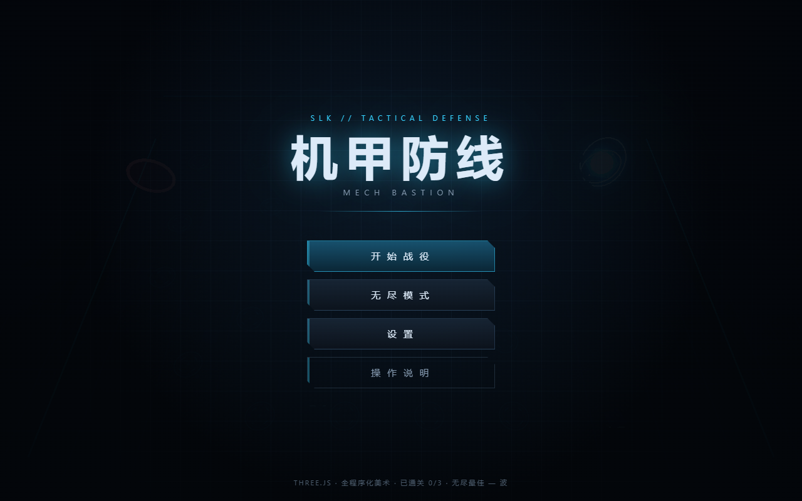
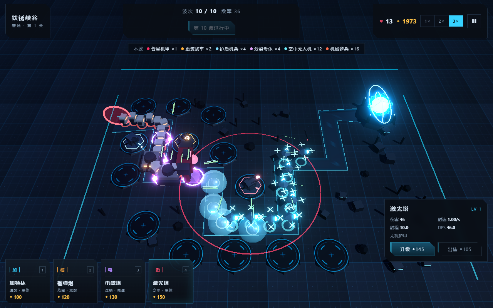

# 机甲防线 · MECH BASTION

科幻机甲题材的 3D 塔防，Three.js + TypeScript + Vite。全部美术与音效在代码里程序化生成，
没有任何模型、贴图、字体或音频文件，`dist/` 是一个可以放到任意静态路径下直接访问的纯前端包。





## 玩法

- **固定路线**：敌人沿关卡预设路线推进，只能站在路线旁的建造点上建塔。
- **四座塔，各司其职**：

| 塔 | 定位 | 特性 | 造价 |
| --- | --- | --- | --- |
| 加特林 | 速射 · 单体 | 高射速，可打空中 | 100 |
| 榴弹炮 | 范围 · 溅射 | 抛射落点爆炸，只打地面 | 120 |
| 电磁塔 | 连锁 · 减速 | 闪电在敌人间跳跃并减速 | 130 |
| 激光塔 | 穿甲 · 单体 | 无视护甲，单体伤害最高 | 150 |

- **三关战役 × 10 波**：每关击败第 10 波（含 BOSS）即通关，按漏怪数结算 1～3 星。
- **三档难度**：简单 / 普通 / 困难，影响敌人血量、速度、金币收益与初始生命。
- **无尽模式**：通关任意一关后解锁，第 11 波起按公式递增，每 5 波一次 BOSS，记录最高波次。
- **敌人类型**：步兵、疾行机、重装战车（高护甲）、空中无人机、护盾机兵（护盾可再生）、分裂母体（死后分裂）、督军机甲（BOSS）。

## 操作

| 操作 | 按键 |
| --- | --- |
| 选择塔型 | 数字键 1～4，或点底部塔卡 |
| 建造 | 左键点击发光的建造点 |
| 选中 / 取消 | 左键点塔；右键或 Esc 取消 |
| 升级 / 出售 | U / X（或在右侧面板点按钮） |
| 提前召唤下一波 | 顶部「提前召唤」，按剩余准备时间返金币 |
| 暂停 / 倍速 | 空格 / 顶部 1× 2× 3× |
| 移动 / 缩放镜头 | WASD 或右键拖拽 / 滚轮 |
| 镜头复位 | R |

## 开发命令

```bash
pnpm install
pnpm dev        # 开发服务 http://127.0.0.1:5317
pnpm typecheck  # tsc --noEmit
pnpm build        # 类型检查 + 产出 dist/
pnpm build:single # 额外产出 dist/standalone.html（单文件，双击即玩）
pnpm preview      # 预览 dist/（http://127.0.0.1:5318）
```

开发模式下有验收用的作弊键（仅 `import.meta.env.DEV` 生效，生产包不含）：
`G` +600 金币、`K` 清空当前波、`J` 跳到第 10 波、`L` 生命清零；
右下角还会显示帧率与当前存活敌人数，方便看性能。

## 平衡测试

`tools/balance.ts` 是无头平衡工具：用脚本化的建造顺序（按路径覆盖度选点、四塔轮转、
有钱就升级、准备过半就提前召唤）跑完指定关卡，输出每波战报与结算，不加载 Three.js。

```bash
pnpm tsx tools/balance.ts        # 三关 × 三难度全跑
pnpm tsx tools/balance.ts 2      # 只跑第 2 关
pnpm tsx tools/endless-check.ts  # 无尽模式冒烟：铺满 13 塔推到 30 波，查数值不崩
```

当前结果（2026-11-17）：简单全部 0 漏怪通关；普通全部通关、0～1 漏怪；困难第 1、3 关在 8 波后失守，
第 2 关剩 4 命通关。改数值后重跑这一条命令即可判断难度变化。

## 部署（二期）

`vite.config.ts` 里 `base: './'`，构建产物使用相对路径，放在 NAS 上任意子目录都能直接打开：

```bash
pnpm build
# 把 dist/ 整个目录拷到 NAS 静态目录下，例如 /vol2/1000/web/mech-bastion/
# 访问 http://<nas>:<port>/mech-bastion/ 即可，无需改任何配置
```

已实测：把 `dist/` 放到子路径 `/game/` 下用静态服务器访问，页面、资源、存档全部正常。

另外 `pnpm build:single` 会把 JS/CSS 内联成 **`dist/standalone.html` 单文件**（约 650 KB），
不启服务、直接双击用 `file://` 打开也能玩——和这一系列其它 3D 小游戏同形态。

## 目录

```text
src/
  core/      固定步长循环、音频合成、随机数、数学
  data/      塔 / 敌人 / 关卡 / 难度 / 波次 数值（改平衡只动这里）
  game/      纯模拟：路径、塔、敌人、弹道、波次、经济
  render/    Three.js 场景、程序化模型、程序化贴图、特效、镜头
  ui/        DOM 界面：主菜单、选关、HUD、暂停、结算、设置
  save.ts    localStorage 存档
tools/
  balance.ts 无头平衡测试
```
