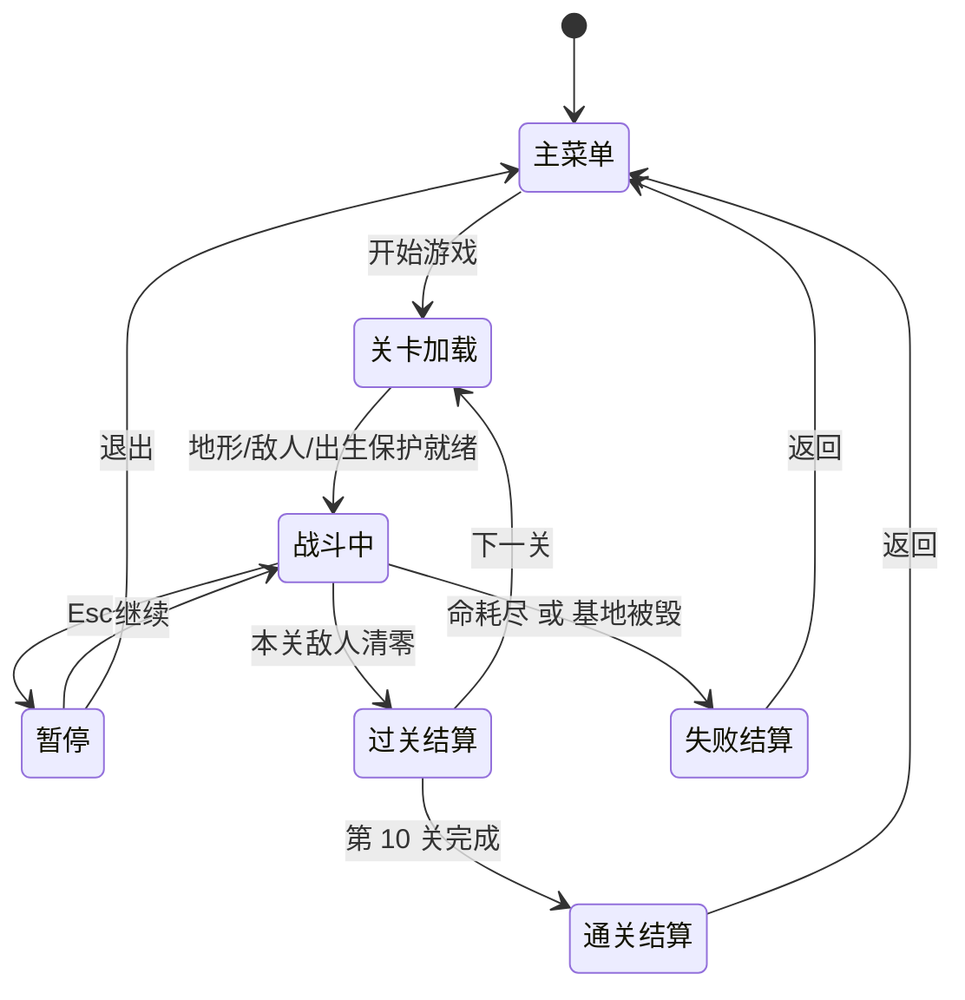
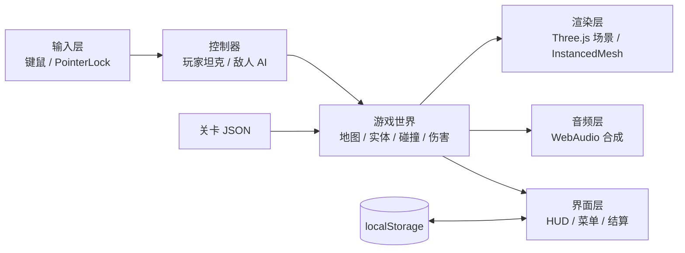

# 3D 坦克大战 · 需求规格 v0.1

| 项目 | 内容 |
|---|---|
| 版本 | v0.1（需求已确认，待冻结后进实现） |
| 日期 | 2026-11-16 |
| 状态 | 待用户确认冻结 |
| 唯一来源 | 本文档是需求与验收的唯一来源；改需求先改本文档 |

## 1. 一句话目标

在浏览器里用 **Three.js + TypeScript** 把《坦克大战》（Battle City）的规则内核复刻出来，用 3D 表现和第三人称操控重新包装成 **单人 PvE 小游戏**：10 关、多地形、4 种道具、程序合成音效、本地存档，构建成可部署的静态站。

## 2. 已确认决策

| 维度 | 决定 | 依据（第一性理由） |
|---|---|---|
| 核心玩法 | 经典 Battle City 规则 3D 重制 | 该规则经三十年验证：目标单一（守基地）、读图即懂（砖墙走廊）、难度靠波次而非数值堆砌 |
| 平台 | 浏览器 + Three.js + TypeScript | 零安装、改一行刷新即见、一条链接即可分发；WebGL2 已覆盖全部目标机器 |
| 模式 | 单人 PvE | 单机即可闭环验证全部玩法；联网需服务端与状态同步，成本是单机数倍，归二期 |
| 范围 | 完整小游戏（10 关、多地形、道具、音效、UI、存档） | 你要的是能给别人玩的完成度，不是技术演示 |
| 美术 | Low-poly / 程序化几何 | 零外部资源 → 零下载体积、零授权风险、风格天然统一 |
| 操作 | 第三人称跟随 + 键鼠（pointer lock） | 与 3D 视角匹配；键鼠瞄准精度远高于手柄 |
| 坦克操控 | 自由移动 + 炮塔独立 360° 旋转 | 真实坦克的物理事实就是底盘与炮塔分离；也是第三人称视角下唯一不别扭的操控 |
| 经典元素 | 精选核心 | 全量复刻（含冰面、时钟）工作量 +40%，体验增益接近零 |
| 失败条件 | 双难度档：经典档忠于原作，休闲档加宽容度 | 一局秒结束会劝退新玩家，但原作手感是核心卖点，两者都要 |
| 音频 | WebAudio 程序合成 | 零素材依赖；炮击/爆炸这类瞬态音用噪声+包络合成效果足够 |
| 交付 | Vite 工程 + 静态构建包 | 既能本地开发调试，也能直接扔到 NAS 出链接 |
| 存档 | localStorage | 无需服务端；保存最高分、最高关、设置 |

## 3. 规则需求（可验收）

### 3.1 一局的完整流程



### 3.2 规则清单

| 编号 | 规则 |
|---|---|
| R1 | 玩家 3 条命；被击毁后 2 秒在本关出生点重生，出生后 3 秒无敌闪烁 |
| R2 | 每关敌人总数 20（经典档）/ 14（休闲档），同屏最多 4 个，按波次补充 |
| R3 | 击毁敌人得分：普通 100、快速 200、装甲 400；拾取道具 500 |
| R4 | 基地（老鹰）位于地图底部中央 2×2 格，被敌方子弹命中即按难度规则判定 |
| R5 | 经典档：基地一击即毁，立即失败。休闲档：基地 3 格血量，被毁后自动修复一次（回满） |
| R6 | 玩家命耗尽 → 立即失败 |
| R7 | 本关敌人全部消灭 → 过关结算 → 下一关；第 10 关完成 → 通关 |
| R8 | 玩家火力 3 档：1 级单发、2 级同屏双发、3 级双发且可击穿钢墙 |
| R9 | 拾取「星」使火力 +1（上限 3 级）；玩家被击毁后火力降回 1 级 |
| R10 | 子弹与地形/坦克碰撞即消失；子弹之间相互抵消（原作行为，保留） |
| R11 | 坦克不能穿越钢墙、砖墙、水；子弹不能穿钢墙（低火力）/砖墙/水（子弹可越水） |
| R12 | 树林遮挡视线但可自由进出；水挡车不挡弹 |
| R13 | 计时/暂停：Esc 暂停，暂停时游戏逻辑冻结 |

### 3.3 地形

| 类型 | 玩家 | 子弹 | 说明 |
|---|---|---|---|
| 砖墙 | 阻挡 | 可击毁（逐块） | 砖墙由 0.5 m 小块组成，命中只毁被命中的那一块 |
| 钢墙 | 阻挡 | 1～2 级弹不可破，3 级可破 | 破坏后留下缺口 |
| 水 | 阻挡 | 可通过 | 视觉上是水面波动材质 |
| 树林 | 可通行 | 可通过 | 半透明遮挡，第三人称视角会被挡住（战术意义保真） |

### 3.4 敌人（3 类）

| 类型 | 血量 | 速度 | 弹速 | 行为侧重 |
|---|---|---|---|---|
| 普通坦克 | 1 | 2.5 m/s | 30 m/s | 直奔基地，遇阻绕行 |
| 快速坦克 | 1 | 4.5 m/s | 30 m/s | 优先追玩家，高速绕后 |
| 装甲坦克 | 3 | 2.0 m/s | 36 m/s | 中距离对射，血厚 |

### 3.5 道具（4 类，击毁闪烁敌人掉落）

| 道具 | 效果 |
|---|---|
| 星 | 玩家火力 +1（上限 3 级） |
| 手雷 | 立即消灭场上全部敌人（计分） |
| 头盔 | 玩家 10 秒无敌 |
| 铲子 | 基地周围一圈砖墙变钢墙，持续 20 秒后恢复 |

### 3.6 关卡

- 共 **10 关**，手工设计，存为 JSON（地形网格 + 敌人波次配置 + 出生点）。
- 难度曲线靠三件事递进：敌人类型比例、AI 反应时间（1.2 s → 0.6 s）、场地复杂度。
- 每关地图 26×26 格，格边长 2.0 m，战场 52 m × 52 m。

## 4. 3D 化必须裁决的两处冲突

### 4.1 格子规则 vs 自由移动

经典规则的战术价值全部依赖**格子化空间**（砖墙是 2 m 见方的掩体、走廊宽度固定、转角可预判）。若改成任意角度地形，玩家会失去读图能力。

**裁决**：地形与碰撞体**仍是格子对齐**（26×26），但坦克和子弹是**连续坐标**的自由刚体。即「地图离散、实体连续」。这样既保住经典可读性，又得到 3D 的顺滑移动。

### 4.2 视角与炮塔

第三人称跟随 + 鼠标瞄准要求炮塔独立于车体；经典规则隐含「炮口只能朝车头」。

**裁决**：车体自由转向（WASD），炮塔相对车体 360° 独立旋转（鼠标），开火沿炮塔朝向。为补偿自由度带来的命中率上升，敌人 AI 具备对提前量的预判射击，并保留「子弹可被抵消」机制。

## 5. 系统需求

### 5.1 模块结构



### 5.2 渲染与性能

- Three.js（当前稳定版）+ WebGL2；单方向光 + 阴影贴图，无后处理。
- 砖墙/钢墙/水面/树林用 `InstancedMesh` 合批，全场 draw call ≤ 150。
- 目标：1080p、60 fps，中端核显（Intel Iris Xe 级）不掉帧。
- 不加载任何外部贴图/模型/字体文件；几何与颜色全部代码生成。

### 5.3 相机

- 第三人称跟随：位于坦克后上方，距离 9 m、高度 5 m、俯角 28°，位置与朝向用弹簧阻尼平滑。
- 相机跟随**车体朝向**而非炮塔朝向（否则转炮塔时画面跟着晃，无法瞄准）。
- 滚轮可拉近/拉远（6～14 m）；相机与地形/墙体做遮挡处理（被挡住时自动拉近）。

### 5.4 碰撞与命中

- 坦克 AABB × 地图格 AABB 检测，逐轴解算滑动（撞墙不卡死）。
- 子弹采用**连续检测**（射线 + 上一帧位置），避免高速弹穿透薄墙。
- 伤害与命中判定与帧率无关。

### 5.5 音效（WebAudio 合成）

炮击（噪声爆破 + 低频冲击）、爆炸（噪声 + 低通扫频）、引擎（循环噪声 + 带通 + 随速度调参）、拾取、过关/失败 jingle。首次用户点击后解锁 `AudioContext`。全局音效/音乐开关，音量可调。

### 5.6 敌人 AI

- 寻路：在 26×26 格上做 A*（8 邻接，砖墙视为高代价、钢墙/水不可走）。
- 行为：状态机 巡逻 → 寻路接近目标 → 有视线且在射程内 → 停车瞄准射击（带提前量）→ 血量低或受击 → 找掩体后撤。
- 反应时间、瞄准误差、开火间隔全部参数化，按关卡难度曲线注入。

### 5.7 界面

主菜单（开始 / 难度切换 / 音效开关 / 最高分）、HUD（命数、关卡、剩余敌人、火力等级、得分）、暂停面板、过关结算、失败结算、通关结算。全部用 DOM + CSS 实现（不上 UI 库）。

### 5.8 存档

`localStorage` 键 `tank3d.save.v1`：最高分、最高通关关卡、难度偏好、音效/音乐开关与音量。读到损坏数据时回退默认值，不崩溃。

## 6. 技术选型与工程

- 构建：Vite + TypeScript（strict）。
- 依赖：`three` 一个运行时依赖，其余工具链为 devDependencies。
- 测试：Vitest，对**不依赖渲染**的核心逻辑做单测：地图碰撞、伤害与火力档、A\* 寻路、关卡 JSON 校验、存档读写。
- 结构（初定，实现可微调）：

```text
src/
├── core/       世界、实体、碰撞、伤害、时间步
├── game/       玩家控制、敌人 AI、波次、规则判定
├── render/     Three.js 场景、材质、相机、特效
├── audio/      WebAudio 合成器
├── ui/         菜单、HUD、结算
├── levels/     关卡 JSON 与加载校验
└── main.ts     装配与主循环
```

- 命令：`npm run dev` / `npm run build` / `npm run preview` / `npm run test`。
- 构建产物 `dist/` 为纯静态，可离线打开（除 WebGL 外无网络依赖）。

## 7. 验收标准

| 编号 | 验收项 | 判据 |
|---|---|---|
| A1 | 可启动 | `npm run dev` 后 5 秒内进入主菜单，开始游戏后立即可操作 |
| A2 | 操控 | 车体自由移动不卡墙；炮塔 360° 跟手；左键开火无拖影 |
| A3 | 命中 | 30 m/s 子弹对 0.5 m 砖块不穿透；命中判定与帧率无关（30/60/120 fps 一致） |
| A4 | 地形 | 砖墙逐块破坏；钢墙仅 3 级火力可破；水挡车不挡弹；树林可进出并遮挡视线 |
| A5 | 敌人 | 按关卡配置刷新；能寻路接近并开火；被击毁计分正确 |
| A6 | 道具 | 4 种道具均生效且持续时间正确 |
| A7 | 流程 | 10 关可通；命耗尽/基地被毁按难度档正确结束；结算数据正确 |
| A8 | 存档 | 刷新页面后最高分、最高关、设置保留；损坏数据不崩溃 |
| A9 | 性能 | 1080p 保持 60 fps，draw call ≤ 150 |
| A10 | 零外部资源 | 构建产物无任何外部网络请求，控制台无 error |

## 8. 明确不做（本期）

多人 / 联网对战、移动端与触屏、手柄支持、关卡编辑器、皮肤与商城、服务器排行榜、模组系统、原作 35 关全量复刻、冰面地形、时钟道具、重炮敌人类型（可作为二期追加）。

## 9. 实现期可调参数（已给默认值，不阻塞）

| 参数 | 默认值 |
|---|---|
| 玩家前进 / 倒车速度 | 5.0 / 3.0 m/s |
| 车体转向速度 | 160 °/s |
| 炮塔转向速度 | 220 °/s |
| 玩家子弹速度 / 冷却 | 32 m/s / 0.35 s |
| 玩家开火后坐与散布 | 无散布，仅车体轻微后坐动画 |
| 同屏敌人上限 | 4 |
| 出生保护时长 | 3 s |
| 关卡格数 / 格边长 | 26 × 26 / 2.0 m |

## 10. 变更记录

| 版本 | 日期 | 变更 |
|---|---|---|
| v0.1 | 2026-11-16 | 首版：需求收集完成，固化 12 项决策与 13 条规则 |
